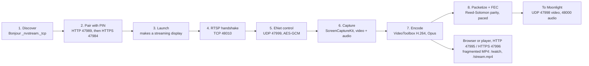

# Moonlight and web streaming — implementation

*As of 2026-10-14 (merged to `main` on 2026-10-13 in 3aa3588). H.264 only, no input
control yet.*

## Summary

DAM is a Moonlight host on its own, without Sunshine. A Moonlight client on the LAN
finds the Mac and pairs with a PIN. It then sees each of DAM's streaming displays as an
app, plus "New Display". Launching "New Display" creates a virtual display at the
client's resolution and frame rate. DAM streams it as H.264 video with Reed-Solomon FEC
and Opus audio. Cancelling from Moonlight removes the display; resuming keeps it,
changed in place to the size the client asks for now.

Apart from Moonlight, DAM also serves displays to browsers and media players, over HTTP
on port 47995 and HTTPS on 47996. It is turned on and set up on its own: the Browser
Stream menu and Settings › Browser Stream, independent of Moonlight hosting and its
settings.

- `/watch` plays the stream in a browser through Media Source Extensions.
- `/stream.mp4` is an endless fragmented MP4 that mpv, ffplay and VLC play as is.
- `/apps.json` lists the displays.

Who may watch (`WebStreamAccess`):

- **Devices.** Each has a token of its own, kept in `Application Support/DAM/Browser/
  devices.json`, and can be forgotten on its own in Settings. A player gets a link
  (`?token=`) from New Player Link…; Open in Browser uses a link named This Mac.
  `/apps.json` and `/stream.mp4` answer 401 without a known token; the page itself is
  open to anyone in reach.
- **Pairing.** A browser without a link asks to pair: the page shows a four-digit code,
  and DAM asks the user to type it. Right, the browser gets an HttpOnly cookie
  (`dam_watch`, a year; Secure when paired over HTTPS). One code at a time, five minutes
  each; a wrong code ends it. Pair with a QR Code… shows a code a phone scans instead:
  a key in the address that works once, for five minutes. "Allow new browsers to pair"
  turns both off.
- **Reach.** This Mac Only, This Mac's Networks (the default: loopback, link-local, or a
  subnet of the Mac's interfaces), or Anywhere. Out of reach gets a 403 for everything.
- **HTTPS.** DAM makes a certificate authority of its own (20 years) and a server
  certificate it signs for the Mac's `.local` name, host name, `localhost`, loopback and
  IPv4 addresses (800 days, as Apple allows at most 825), made again when those change
  or it nears its end. A device trusts the authority once: mpv with `--tls-ca-file`
  (Export Certificate…), an iPhone or iPad by installing `http://<mac>.local:47995/ca.cer`
  and turning on full trust for it. Without that, players that don't check certificates
  (mpv, IINA, ffmpeg by default) still play over HTTPS, and VLC asks once.
- The stream over HTTP crosses the network unencrypted, and with it the tokens.

Three profiles (Interactive, Balanced, Viewing) set the defaults from Settings › Browser
Stream, which also has its own Show the Pointer. Each client can override profile,
bitrate, frame rate and size in the query string, and turn on low-latency encoding with
`lowlatency=1`.

## How it works

A Moonlight session goes from discovery to UDP streams in eight steps. The browser
stream branches off after encoding.

### Discovery and pairing

`MoonlightHost`, `MoonlightPairing`, `MoonlightCrypto`:

- DAM advertises `_nvstream._tcp` over Bonjour.
- Discovery and pairing run over HTTP on 47989. Everything else runs over HTTPS on
  47984, which accepts only paired clients' certificates.
- Pairing follows moonlight-qt's GameStream steps: AES-128-ECB keyed by SHA-256 of the
  salt and PIN, with challenges hashed using each side's certificate signature.
- The host key, its self-signed certificate and the paired-client list are stored in
  Application Support, readable only by the user. The TLS identity is built in memory,
  so the keychain isn't involved.

### Several devices

Each paired device has a session of its own, from /launch until /cancel, up to four at
once (`MoonlightHost.maxSessions`). A fifth gets a 503.

- Session *n* (0 to 3) has RTSP on TCP 48010 + *n*, given in /launch's `sessionUrl0`, and
  its stream on UDP 47998–48000 + 100 × *n*, given in the SETUP replies. The first
  session's are GameStream's, which port forwards are set up for.
- `/serverinfo` and `/cancel` are the asking device's own: a device sees its own launch
  as running and the host free otherwise, so Moonlight never asks it to quit another
  device's app.
- Each stream has its own encoder, bitrate, keyframes, FEC and encryption. Streams of one
  display at one size, rate and pointer setting share one capture (`SharedScreenCapture`),
  sound included; one that joins gets the last picture at once.
- A display made for one device that another device streams too stays until both are
  done.
- The menu lists the devices streaming, each with End Stream.
- On the test Mac (Intel Iris Plus 650), three 1080p60 encoders at once kept their
  frames within 25 ms (p90); with four, the slowest tenth took 43–83 ms.

### RTSP and control

`MoonlightRTSP`, TCP 48010 (and one port on per further session):

- DESCRIBE offers H.264 only. It supports encrypted control and audio, and encrypted
  video when Settings › Moonlight › Encrypt Video says so for the client's address: Off
  the Local Network (the default, as Sunshine's), Always or Never. "Local" is loopback,
  link-local, or a subnet of one of the Mac's interfaces. Nothing is required, so a client
  without fast AES may leave video plain.
- ANNOUNCE is parsed for size, fps, packet size, bitrate, minimum FEC and audio
  settings. It is refused if the client asks for another codec, or for encrypted video
  that wasn't offered.
- Control runs on UDP 47999 over vendored ENet 1.3.18, with AES-128-GCM messages. Only
  keyframe requests, reference-frame invalidation and termination are handled.

### Video

`MoonlightScreenCapture` → `MoonlightVideoEncoder` → `MoonlightPacketizer` /
`MoonlightFEC` → UDP 47998:

- **Capture:** ScreenCaptureKit captures in 4:2:0 at the stream's size and rate, with a
  queue depth of 6, shared between streams that want the same.
- **Encoding:** VideoToolbox hardware H.264 (High profile, CABAC, real time, no frame
  reordering, keyframes only on request).
- **Nudge:** the encoder holds each frame until the next one arrives. So if no new frame
  follows within 1.25 frame times, DAM resubmits the last picture to flush it.
- **Low-latency encoding (default for Moonlight):** Apple's low-latency rate control returns each frame
  as soon as it is encoded, so no nudge is needed. On the Intel test Mac it marks frames
  long-term and predicts from them, which FFmpeg (Moonlight everywhere, mpv, ffplay, VLC)
  can't follow with the one reference frame Moonlight allows. The long-term frame is always
  the one just before, so DAM rewrites those slice headers into plain ones that decode to
  the same pictures (`H264OneReference.swift`). It is on for every paired device unless
  turned off per device in Settings › Moonlight; on the test Mac it cut the median delay from 84 to
  56 ms. A browser stream asks for it with `lowlatency=1`, and the Viewing profile
  ignores it.
- **Sending:** a separate thread paces packets at 6× the bitrate, between 60 and
  400 Mbit/s. Encoded frames are never dropped. When the sender falls behind, capture
  skips a frame before encoding it.
- **FEC:** each frame is split into up to four blocks, each with 20% Reed-Solomon parity
  (nanors-compatible), or more if the client asks for it.
- **Encryption:** when the client turned it on, each packet, data and parity alike, is
  sealed after parity is worked out: AES-128-GCM under the launch's key, sent behind a
  32-byte prefix of the nonce (a packet counter, three zeros and "V"), the frame index in
  the clear, and the tag (`MoonlightVideoCrypto`).
- **Still screen:** the last picture is resent every 0.5 s.
- **Keyframe requests:** at most one keyframe per 0.25 s. A request is skipped while the
  keyframe asked for is still to be sent, or when it arrives less than a round trip (at
  most 0.3 s) after a keyframe went out. Moonlight asks again for every frame it loses
  while it waits, so on a lossy link answering each request kept the stream in a run of
  keyframes.
- **Bitrate:** set from the client's losses, which it reports for each frame it could not
  rebuild from parity (Sunshine's 0x5502) and by asking for keyframes. Two or more losses
  in a second cut it by 30% if a frame came four or more packets short in the last 10 s
  (lost in a run, as an overflowing link drops them; random loss leaves them one to three
  short); ten or more losses of any kind halve it, then it holds for 2 s. Five
  seconds without a loss, and with no more than two frames rebuilt from parity a second,
  raise it by 15%. It stays between the client's bitrate and a quarter of it (no less than
  2 Mbit/s). Cuts are judged on the 10 s after them: unless losses fell by half against
  the 10 s before, it goes back to the bitrate before them, and only ten or more losses a
  second cut it for the next 30 s. That is for random loss, which a lower bitrate does not
  lessen and fewer parity packets per frame make worse. The first 3 s of a stream, when
  Moonlight asks for a keyframe and loses frames as it starts, count for nothing. Turning off
  "Adapt the bitrate to the network" in Settings › Moonlight keeps the client's bitrate throughout.

### Audio

UDP 48000. System audio at 48 kHz stereo, without DAM's own sounds.

- It is encoded to constant-bitrate Opus in 5 ms packets, at 512 or 96 kbit/s depending
  on the client.
- Packets can be encrypted, with parity after every fourth packet. They are paced from a
  queue of at most 40 ms, and silence fills the gaps.

### Streaming displays

`VideoManager+StreamingDisplay`: standalone `CGVirtualDisplay`s, at most four, each with
its own name and serial.

- A stream up to 2560 px wide gets a 1x display of its size. A wider one gets a HiDPI
  display at half the size.
- DAM places each display to the right of the others. It puts back any resolution
  WindowServer changes on other displays, and hands "main" back if the streaming display
  took it.

### Browser and player stream

`WebStream`, `MP4Fragmenter`, TCP 47995 and 47996 (`WebStreamServer`, listeners of its
own): one MP4 fragment per frame, H.264 plus AAC at 48 kHz.

- Viewers of the same display with the same settings share one capture and one encoder.
- A new viewer starts at a keyframe. A viewer more than 1 s behind skips ahead to the
  next keyframe.
- Frames snap to a fixed grid, and slots where the screen didn't change repeat the last
  picture. Browsers stall on any gap, so this stream never nudges the encoder. Silence
  keeps the audio within 50 ms of the video.
