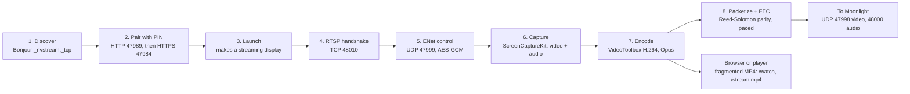

# Moonlight and web streaming — implementation

*As of 2026-10-14 (merged to `main` on 2026-10-13 in 3aa3588). H.264 only, no input
control yet.*

## Summary

DAM is a Moonlight host on its own, without Sunshine. A Moonlight client on the LAN
finds the Mac and pairs with a PIN. It then sees each of DAM's streaming displays as an
app, plus "New Display". Launching "New Display" creates a virtual display at the
client's resolution and frame rate. DAM streams it as H.264 video with Reed-Solomon FEC
and Opus audio. Cancelling from Moonlight removes the display; resuming keeps it,
changed in place to the size the client asks for now.

The same HTTP port (47989) also serves displays to browsers and media players:

- `/watch` plays the stream in a browser through Media Source Extensions.
- `/stream.mp4` is an endless fragmented MP4 that mpv, ffplay and VLC play as is.
- `/apps.json` lists the displays.

Three profiles (Interactive, Balanced, Viewing) set the defaults from the Moonlight
menu. Each client can override profile, bitrate, frame rate and size in the query
string, and turn on low-latency encoding with `lowlatency=1`.

## How it works

A Moonlight session goes from discovery to UDP streams in eight steps. The browser
stream branches off after encoding.

### Discovery and pairing

`MoonlightHost`, `MoonlightPairing`, `MoonlightCrypto`:

- DAM advertises `_nvstream._tcp` over Bonjour.
- Discovery and pairing run over HTTP on 47989. Everything else runs over HTTPS on
  47984, which accepts only paired clients' certificates.
- Pairing follows moonlight-qt's GameStream steps: AES-128-ECB keyed by SHA-256 of the
  salt and PIN, with challenges hashed using each side's certificate signature.
- The host key, its self-signed certificate and the paired-client list are stored in
  Application Support, readable only by the user. The TLS identity is built in memory,
  so the keychain isn't involved.

### RTSP and control

`MoonlightRTSP`, TCP 48010:

- DESCRIBE offers H.264 only. It supports encrypted control and audio, but not
  encrypted video.
- ANNOUNCE is parsed for size, fps, packet size, bitrate, minimum FEC and audio
  settings. It is refused if the client asks for another codec or for encrypted video.
- Control runs on UDP 47999 over vendored ENet 1.3.18, with AES-128-GCM messages. Only
  keyframe requests, reference-frame invalidation and termination are handled.

### Video

`MoonlightScreenCapture` → `MoonlightVideoEncoder` → `MoonlightPacketizer` /
`MoonlightFEC` → UDP 47998:

- **Capture:** ScreenCaptureKit captures in 4:2:0 at the stream's size and rate, with a
  queue depth of 6.
- **Encoding:** VideoToolbox hardware H.264 (High profile, CABAC, real time, no frame
  reordering, keyframes only on request).
- **Nudge:** the encoder holds each frame until the next one arrives. So if no new frame
  follows within 1.25 frame times, DAM resubmits the last picture to flush it.
- **Low-latency encoding (optional):** Apple's low-latency rate control returns each frame
  as soon as it is encoded, so no nudge is needed. It's off by default because FFmpeg
  (Moonlight on Linux and Windows, mpv, ffplay, VLC) shows a broken picture with it. Turn
  it on per paired device in the Moonlight menu, or with `lowlatency=1` for a browser
  stream. The Viewing profile ignores it.
- **Sending:** a separate thread paces packets at 6× the bitrate, between 60 and
  400 Mbit/s. Encoded frames are never dropped. When the sender falls behind, capture
  skips a frame before encoding it.
- **FEC:** each frame is split into up to four blocks, each with 20% Reed-Solomon parity
  (nanors-compatible), or more if the client asks for it.
- **Still screen:** the last picture is resent every 0.5 s. Keyframes are limited to one
  per 0.25 s.
- **Bitrate:** set from the client's losses, which it reports for each frame it could not
  rebuild from parity (Sunshine's 0x5502) and by asking for keyframes. Two or more lost
  frames in a second cut it by 30%, ten or more by half, then it holds for 2 s. Five
  seconds without a loss, and with no more than two frames rebuilt from parity a second,
  raise it by 15%. It stays between the client's bitrate and a quarter of it (no less than
  2 Mbit/s). Cuts are judged on the 10 s after them: unless losses fell by half against
  the 10 s before, it goes back to the bitrate before them, and only ten or more losses a
  second cut it for the next 30 s. That is for random loss, which a lower bitrate does not
  lessen and fewer parity packets per frame make worse. The default
  `MoonlightAdaptiveBitrate` set to false keeps the client's bitrate throughout.

### Audio

UDP 48000. System audio at 48 kHz stereo, without DAM's own sounds.

- It is encoded to constant-bitrate Opus in 5 ms packets, at 512 or 96 kbit/s depending
  on the client.
- Packets can be encrypted, with parity after every fourth packet. They are paced from a
  queue of at most 40 ms, and silence fills the gaps.

### Streaming displays

`VideoManager+StreamingDisplay`: standalone `CGVirtualDisplay`s, at most four, each with
its own name and serial.

- A stream up to 2560 px wide gets a 1x display of its size. A wider one gets a HiDPI
  display at half the size.
- DAM places each display to the right of the others. It puts back any resolution
  WindowServer changes on other displays, and hands "main" back if the streaming display
  took it.

### Browser and player stream

`WebStream`, `MP4Fragmenter`: one MP4 fragment per frame, H.264 plus AAC at 48 kHz.

- Viewers of the same display with the same settings share one capture and one encoder.
- A new viewer starts at a keyframe. A viewer more than 1 s behind skips ahead to the
  next keyframe.
- Frames snap to a fixed grid, and slots where the screen didn't change repeat the last
  picture. Browsers stall on any gap, so this stream never nudges the encoder. Silence
  keeps the audio within 50 ms of the video.
